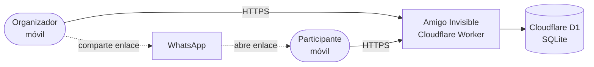
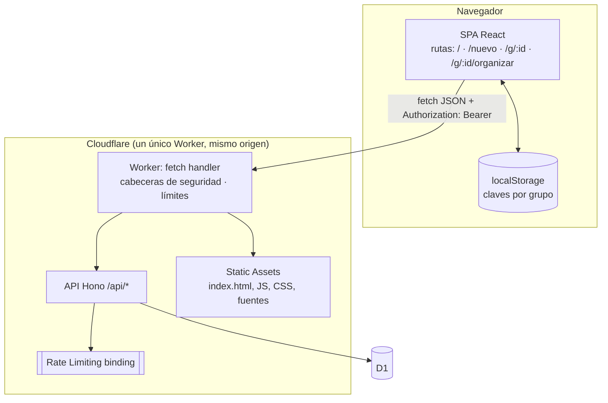
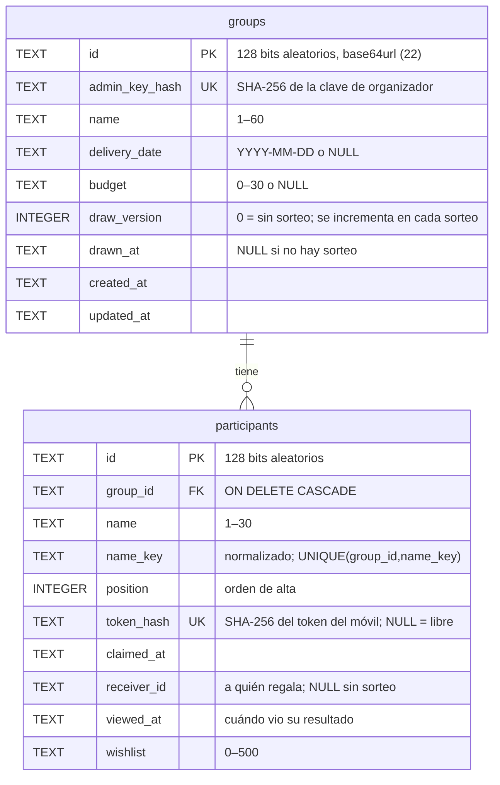
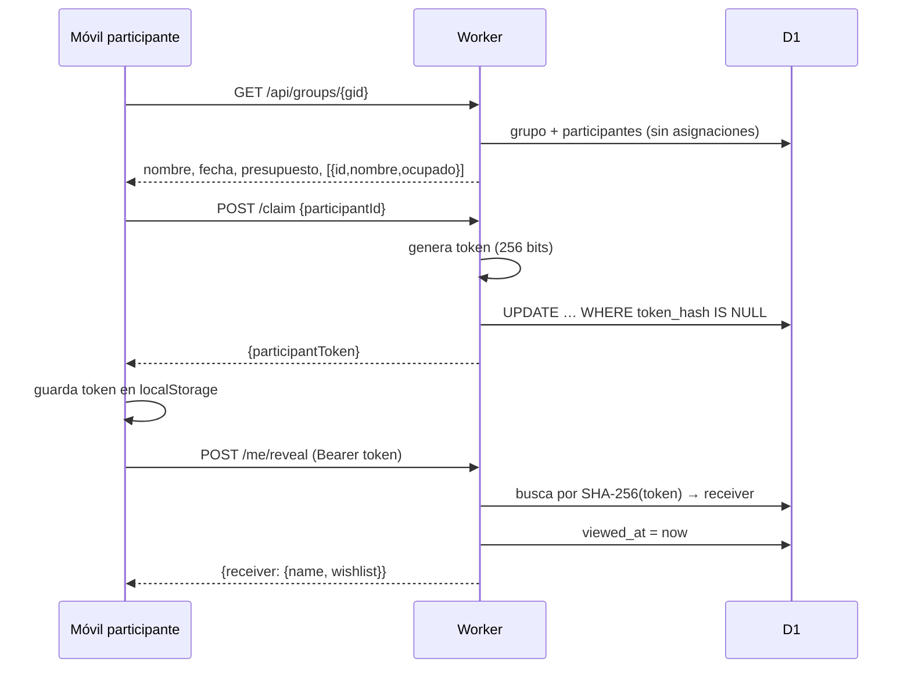

| ID | Versión | Estado | Fecha |
|---|---|---|---|
| ARQ | 1.0.0 | Aprobado | 2026-10-12 |

# Arquitectura · Amigo Invisible

Deriva de `SPEC` 1.0.0. Las decisiones y sus alternativas están en [`adr/`](adr/).

## 1. Vista de contexto (C4 nivel 1)



No hay más sistemas externos: ni correo, ni analítica, ni CDN de terceros. WhatsApp solo recibe un enlace `https://wa.me/?text=…` que abre el propio móvil del usuario (ADR-0006).

## 2. Vista de contenedores (C4 nivel 2)



- **Un solo Worker** sirve la SPA y la API en el mismo origen (ADR-0003). Todas las peticiones pasan por el Worker (`run_worker_first`) para aplicar cabeceras de seguridad uniformes (ADR-0011).
- **Sin cookies**: la identidad viaja en `Authorization: Bearer` desde `localStorage` (ADR-0006), lo que elimina CSRF por diseño.

## 3. Vista de componentes (código)

```
src/
├── shared/            Código común cliente/servidor (sin dependencias de plataforma)
│   ├── limits.ts      Límites de negocio (3–40 personas, longitudes) — única fuente
│   ├── normalize.ts   Normalización de nombres (comparación sin acentos/mayúsculas)
│   ├── schemas.ts     Esquemas zod de peticiones/respuestas (contrato tipado)
│   └── errors.ts      Códigos de error de la API
├── worker/            Backend (Cloudflare Worker)
│   ├── index.ts       Punto de entrada: enruta /api a Hono y el resto a ASSETS
│   ├── app.ts         Composición de la app Hono y middlewares
│   ├── routes/        public.ts · participant.ts · admin.ts
│   ├── domain/        draw.ts (sorteo, puro) · status.ts
│   ├── db/            repo.ts (todas las consultas SQL, parametrizadas)
│   └── security/      crypto.ts · auth.ts · headers.ts · rate-limit.ts
└── client/            Frontend (SPA React)
    ├── main.tsx · App.tsx (rutas)
    ├── pages/         Home · CreateGroup · Organizer · EditGroup · Participant · NotFound
    ├── components/    Button · Dialog · Field · Toast · Layout · ...
    ├── lib/           api.ts · storage.ts · whatsapp.ts · dates.ts
    ├── i18n/es.ts     Todos los textos visibles (RNF-12)
    └── styles/        tokens.css · base.css
migrations/            SQL versionado de D1
tests/                 unit · integration · e2e (Playwright)
```

Reglas de dependencia: `client` → `shared` ← `worker`. `domain/` no conoce HTTP ni base de datos. Solo `db/repo.ts` contiene SQL.

## 4. Modelo de datos



Estado del participante para el organizador (RF-12): `sin entrar` (`token_hash IS NULL`), `ha entrado` (`token_hash` y `viewed_at IS NULL`), `ha visto` (`viewed_at` no nulo).

**Concurrencia**:
- Elegir nombre: `UPDATE … SET token_hash=? WHERE id=? AND token_hash IS NULL` y se comprueba `changes = 1` (CA-07.4).
- Sorteo: control optimista sobre `draw_version`; las asignaciones y el incremento se escriben en un único `batch` transaccional de D1 (CA-05.5).

## 5. API (resumen)

Contrato completo: [`api/openapi.yaml`](api/openapi.yaml).

| Método y ruta | Quién | Requisitos |
|---|---|---|
| `POST /api/groups` | Cualquiera (con límite) | RF-01, RF-02 |
| `GET /api/groups/{gid}` | Con el enlace del grupo | RF-07 |
| `POST /api/groups/{gid}/claim` | Con el enlace del grupo | RF-07, CA-07.4/5 |
| `GET /api/groups/{gid}/me` | Participante (token) | RF-08, RF-09, RF-10 |
| `POST /api/groups/{gid}/me/reveal` | Participante | RF-09, RF-11 |
| `PUT /api/groups/{gid}/me/wishlist` | Participante | RF-10 |
| `DELETE /api/groups/{gid}/me/claim` | Participante | RF-15 |
| `GET /api/groups/{gid}/admin` | Organizador (clave) | RF-02, RF-12 |
| `PATCH /api/groups/{gid}/admin` | Organizador | RF-04, CA-05.4 |
| `POST /api/groups/{gid}/admin/draw` | Organizador | RF-05, RF-06 |
| `DELETE /api/groups/{gid}/admin/draw` | Organizador | RF-06 |
| `POST /api/groups/{gid}/admin/participants/{pid}/release` | Organizador | RF-14 |
| `DELETE /api/groups/{gid}/admin` | Organizador | RF-16 |
| `GET /api/health` | Cualquiera | Operación |

Errores: `{"error": "<CODIGO>"}` con estado HTTP adecuado; el cliente traduce el código a un texto llano (RF-20). Nunca se devuelven trazas.

## 6. Flujos críticos

### Elegir nombre y ver resultado


### Sorteo
`domain/draw.ts` baraja los participantes con Fisher–Yates usando `crypto.getRandomValues` con muestreo por rechazo (sin sesgo de módulo) y asigna a cada uno el siguiente en el círculo (ADR-0007).

## 7. Despliegue

Ver `docs/07-despliegue`. Resumen: GitHub Actions → lint, tipos, pruebas → `wrangler d1 migrations apply` → `wrangler deploy` → pruebas E2E contra producción.

## Historial
| Versión | Fecha | Cambio |
|---|---|---|
| 1.0.0 | 2026-10-12 | Versión inicial derivada de SPEC 1.0.0 |
