| ID | Versión | Estado | Fecha |
|---|---|---|---|
| GUIA | 0.3.0 | Pendiente de validar con usuarios mayores (Puerta P2) | 2026-10-12 |

# Guía de uso · Amigo Invisible

**Dirección:** https://amigo-invisible.amigo-invisible.workers.dev

> Esta guía está pensada para leerse en voz alta o imprimirse en letra grande. Si a alguien le cuesta entender un paso, **el fallo es de la aplicación, no de la persona**: avísanos para mejorarla.

---

## Para quien participa (por ejemplo, el abuelo o la abuela)

No hay que instalar nada ni poner contraseñas. Solo necesitas WhatsApp.

### 1. Toca el enlace
En el grupo de WhatsApp de la familia verás un mensaje que empieza con un regalo 🎁 y lleva un texto azul subrayado. **Tócalo con el dedo.**

### 2. Toca tu nombre
Se abre una página con todos los nombres en botones grandes. **Toca el tuyo.**

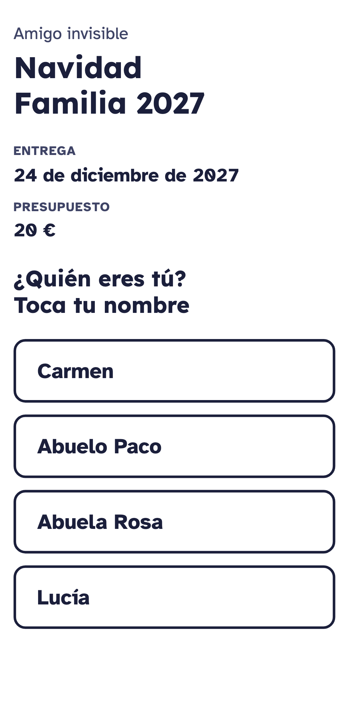

> Si tu nombre tiene el borde de rayitas y pone **"Ya ha entrado"**, es que ya entraste antes desde este móvil… o que alguien se equivocó. Llama a quien organiza y dile: *"Déjame entrar de nuevo"*.
>
> 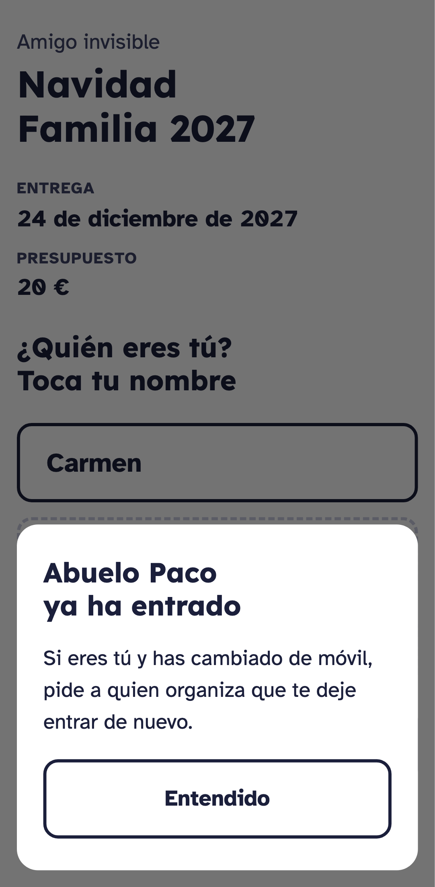

### 3. Di que eres tú
Te preguntará *"¿Eres Abuelo Paco?"*. Toca el botón rojo **"Sí, soy Abuelo Paco"**. Si te has equivocado de nombre, toca **"No"**.

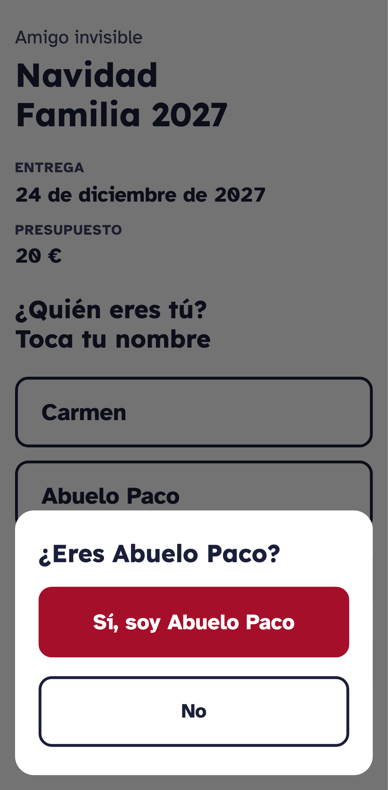

### 4. Si todavía no se ha hecho el sorteo
Verás *"Todavía no se ha hecho el sorteo"*. No pasa nada: **vuelve a tocar el mismo enlace otro día**. Mientras tanto, puedes escribir qué te gustaría que te regalen (paso 6).

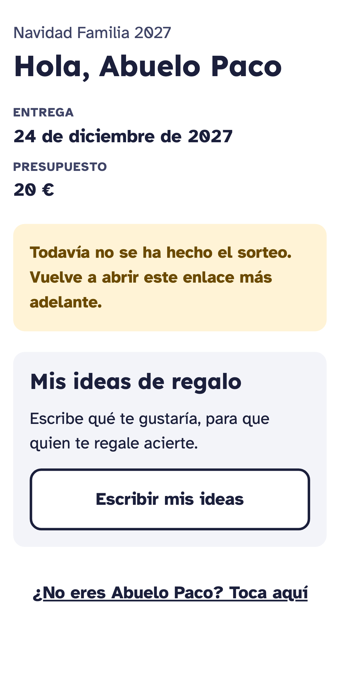

### 5. Mira a quién le regalas
Cuando ya se haya hecho el sorteo, verás el botón rojo **"🎁 Ver a quién regalo"**. Tócalo.

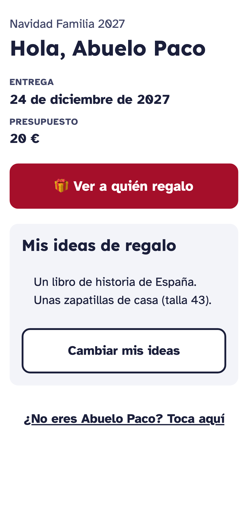

Aparecerá un nombre en grande, en rojo. **¡Esa es la persona a la que le haces el regalo!** No se lo digas a nadie. Debajo verás la fecha, el dinero que hay que gastar más o menos y las ideas de regalo que esa persona haya escrito.

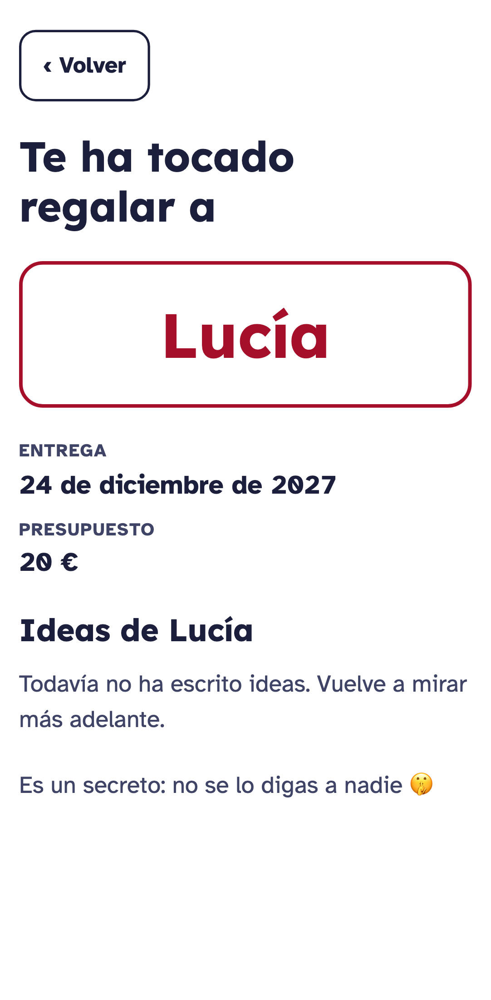

### 6. (Si quieres) Escribe qué te gustaría que te regalen
Toca **"Escribir mis ideas"**, escribe (o dicta con el micrófono del teclado) y toca **"Guardar"**. Lo puedes cambiar cuando quieras, antes o después del sorteo.

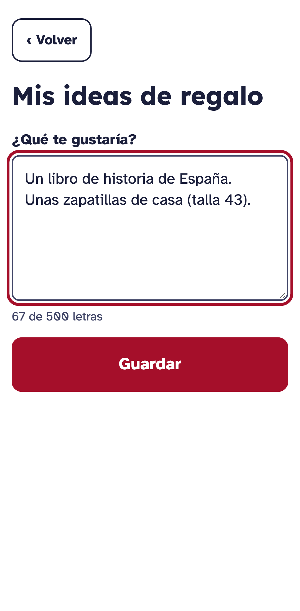

### ¿Y otro día?
Toca **el mismo enlace** de WhatsApp. El móvil te recordará y verás directamente *"Hola, Abuelo Paco"*. Para volver atrás, toca el botón **"‹ Volver"** de arriba.

---

## Para quien organiza

### 1. Crear el amigo invisible
1. Abre la dirección de arriba y toca **"Crear amigo invisible"**.

   
2. Escribe el nombre del grupo (p. ej. *Navidad Familia 2027*), la fecha y el presupuesto (estos dos, si quieres).
3. Escribe cada nombre y toca **"Añadir"**. **No te olvides de ponerte a ti** si participas. Si dos personas se llaman igual, añade una inicial (*Ana G.*, *Ana M.*).
4. Toca **"Crear"**.

   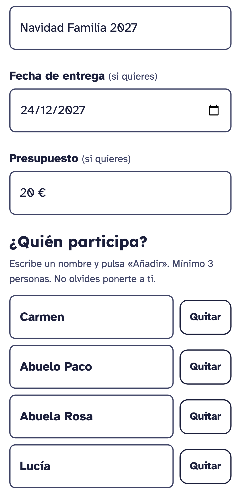

### 2. Enviar el enlace
Toca **"Enviar por WhatsApp"**, elige el grupo de la familia y envía. **Un solo enlace sirve para todos.** No hace falta haber sorteado: cada persona puede ir entrando, elegir su nombre y escribir sus ideas.

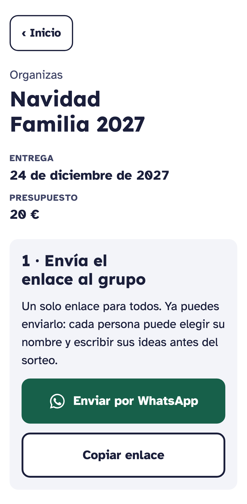

### 3. Corregir y hacer el sorteo
- ¿Un nombre mal escrito? Toca **"Cambiar nombres o datos"**.
- ¿Alguien tocó el nombre de otra persona? Toca **"Dejar entrar de nuevo"** junto a ese nombre.
- Antes del sorteo, corregir no tiene ninguna consecuencia.

Cuando todo esté bien, toca **"Hacer el sorteo"** y confirma. Tú tampoco verás a quién le toca cada uno, así que puedes participar tranquilamente.

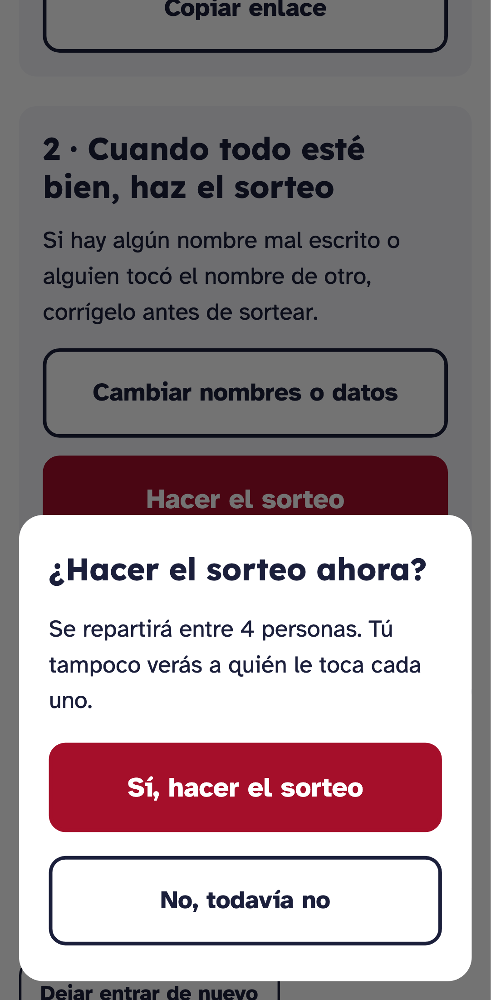

### 4. Ver quién falta
En tu panel verás a cada persona con:
- **Sin entrar**: todavía no ha tocado el enlace.
- **Ha entrado**: eligió su nombre, pero no ha mirado su resultado.
- **✓ Ha visto a su amigo**: ya sabe a quién regala.

Toca **"Recordar por WhatsApp"** para mandar un recordatorio al grupo. Si tú también participas, toca **"Elegir mi nombre"**.

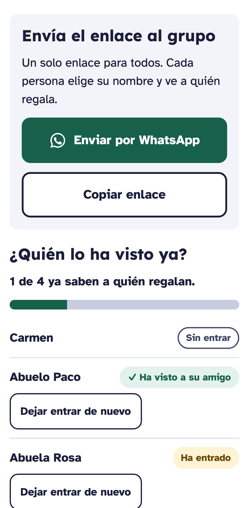

### 5. Guarda tu enlace de organizador
Toca **"Enviármelo por WhatsApp"** y mándatelo a ti mismo (por ejemplo, a tu chat de notas). Si cambias de móvil, con ese enlace vuelves a tu panel. **No lo compartas con nadie.**

### Problemas frecuentes
| Problema | Solución |
|---|---|
| Alguien tocó el nombre de otra persona | Toca **"Dejar entrar de nuevo"** junto a ese nombre. Si ya había visto el resultado, plantéate **"Repetir el sorteo"** (en *Más opciones*). |
| Alguien cambió de móvil o borró el historial | Toca **"Dejar entrar de nuevo"** junto a su nombre. Su amigo invisible no cambia. |
| Me he olvidado de alguien y ya sorteé | *Más opciones* → **"Deshacer el sorteo para cambiar personas"**, añádelo y vuelve a sortear. |
| Quiero cambiar la fecha o el presupuesto después del sorteo | *Más opciones* → **"Cambiar nombre, fecha o presupuesto"**. |
| He perdido mi panel de organizador | Abre el enlace de organizador que te enviaste. Sin él no se puede recuperar (por seguridad): crea un amigo invisible nuevo. |
| Pone "Demasiados intentos" | Espera un minuto y vuelve a intentarlo. |
| Pone "No hay conexión a Internet" | Revisa el wifi o los datos y toca **"Reintentar"**. |

### Al terminar
En *Más opciones* → **"Borrar este amigo invisible"**. Se borran todos los nombres y las ideas de regalo, y el enlace deja de funcionar. Si no lo borras, se queda guardado.

---

*Capturas generadas automáticamente con `node scripts/capture-guide.mjs` sobre la aplicación real.*

## Historial
| Versión | Fecha | Cambio |
|---|---|---|
| 0.1.0 | 2026-10-11 | Primera versión, basada en el prototipo |
| 0.2.0 | 2026-10-12 | Flujo flexible (enviar antes de sortear y corregir); borrado solo manual |
| 0.3.0 | 2026-10-12 | Dirección real, capturas de la aplicación publicada, problemas frecuentes ampliados |
